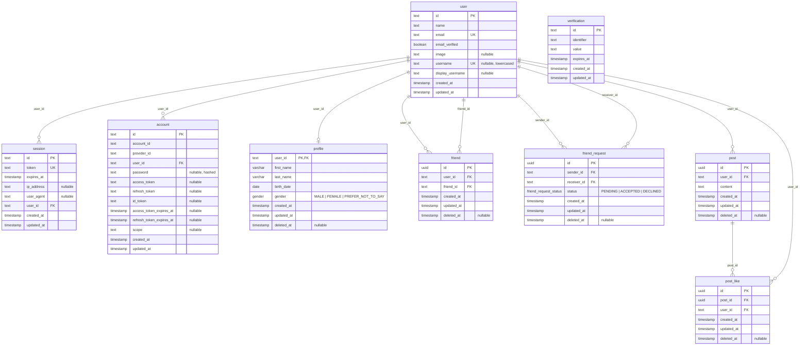

# Database

The schema lives in `database/src/schemas/` (one file per table) and is applied with the Drizzle migrations in `database/src/migrations/`. This page mirrors it; update both together.

## Notes

- **Auth tables** (`user`, `session`, `account`, `verification`) are owned by better-auth and generated into `database/src/schemas/auth.ts` by `pnpm backend:auth:generate`. User ids are better-auth text ids, so every foreign key to `user` is `text`. `username` comes from the better-auth `username` plugin and is stored lowercased; `display_username` keeps the casing the user typed.
- **profile** is created right after signup (`POST /profiles`) and keyed by the user id, so a user has at most one. The frontend sends users without a profile to `/onboarding`. Email and username are read from `user`; the public profile shape returned by the API is the profile plus `username`.
- **friend** stores one row per direction. Accepting a friend request inserts both rows in one transaction, with `ON CONFLICT DO NOTHING` on `(user_id, friend_id)` so re-accepting is harmless.
- **friend_request** starts `PENDING` and is resolved by the receiver to `ACCEPTED` or `DECLINED`. Withdrawing a request soft-deletes it. Only one pending request may exist between two users, in either direction.
- **post_like** has a unique `(post_id, user_id)` pair. Liking again after an unlike clears `deleted_at` on the existing row instead of inserting a new one.
- **Soft deletes:** `profile`, `friend`, `friend_request`, `post` and `post_like` have `deleted_at`; every query filters `deleted_at IS NULL`. The auth tables are deleted for real, and deleting a user cascades to every table that references it.
- **The feed** (`GET /posts`) is the user's own posts plus the posts of everyone in their `friend` rows, newest first.
